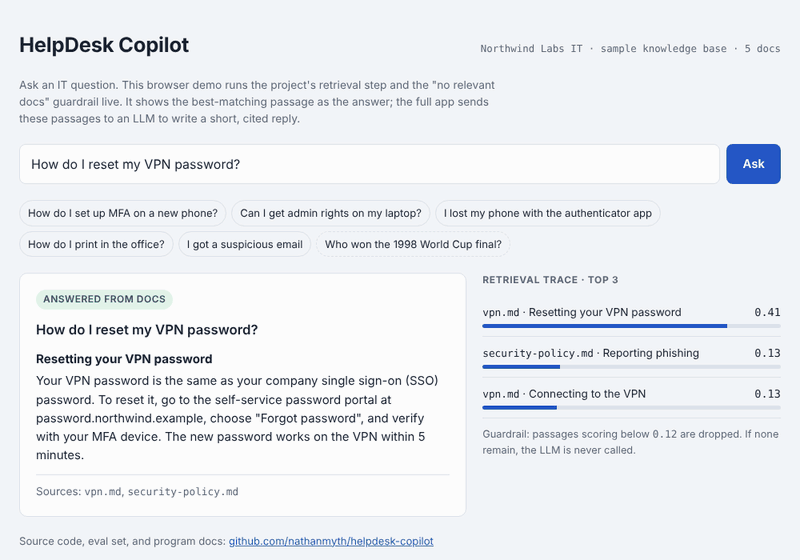

# 🛠️ HelpDesk Copilot

**An AI assistant that answers employee IT questions from internal documentation — run as a full program, from PRD to launch.**

> 📌 **Portfolio note:** This project demonstrates end-to-end AI program management: problem framing, architecture trade-offs, evaluation-driven quality gates, risk management, and launch readiness. The `docs/` folder is as important as the code.


<!-- TODO: record a 15-second GIF of the Streamlit app and replace this -->

**🔗 Try it in your browser:** [nathanmyth.github.io/helpdesk-copilot/demo](https://nathanmyth.github.io/helpdesk-copilot/demo/) — runs the retrieval step and guardrail live, no setup needed.

**🔗 Full app (LLM answers):** _TODO: add Streamlit Community Cloud link_

---

## The problem

Employees file repetitive IT tickets ("How do I reset my VPN?", "Can I install X?"). Answers already exist in internal docs, but nobody can find them. Each ticket costs support time and leaves the employee waiting.

**Goal:** Deflect 30% of tier-1 tickets with grounded, cited answers — without the assistant making things up.

## Results (fill in after running the eval)

| Metric | Target | Baseline (TF-IDF) | Current |
|---|---|---|---|
| Retrieval hit rate @3 | ≥ 90% | 100% | _TBD_ |
| Answer correctness | ≥ 85% | _TBD_ | _TBD_ |
| Correct refusals (out-of-scope Qs) | 100% | _TBD_ | _TBD_ |
| p95 latency | < 4 s | _TBD_ | _TBD_ |
| Est. cost per query | < $0.01 | _TBD_ | _TBD_ |

See [`eval/`](eval/) for the harness and [`docs/05-launch-checklist.md`](docs/05-launch-checklist.md) for the go/no-go criteria.

## Program artifacts

| Doc | What it shows |
|---|---|
| [PRD](docs/01-prd.md) | Problem, users, success metrics, scope, non-goals |
| [Architecture](docs/02-architecture.md) | System design and data flow |
| [Decision records](docs/decisions/) | Key trade-offs (RAG vs fine-tuning, retrieval approach, model choice) |
| [Milestones](docs/03-milestones.md) | Phased plan with exit criteria |
| [Risk register](docs/04-risk-register.md) | AI-specific risks with owners and mitigations |
| [Launch checklist](docs/05-launch-checklist.md) | Go/no-go gates |
| [Retrospective](docs/06-retro.md) | What worked, what didn't, what's next |

## Architecture

```
User question
     │
     ▼
┌─────────────┐   top-k chunks   ┌──────────────┐   prompt + context   ┌─────────┐
│  Retriever  │ ───────────────▶ │ Prompt build │ ───────────────────▶ │   LLM   │
│  (TF-IDF)   │                  │ + guardrails │                      └────┬────┘
└──────▲──────┘                  └──────────────┘                           │
       │ indexed chunks                                     answer + sources │
┌──────┴──────┐                                                             ▼
│  data/docs  │                                                   Streamlit UI / CLI
└─────────────┘
```

## Quick start

```bash
git clone https://github.com/<your-username>/helpdesk-copilot.git
cd helpdesk-copilot
python -m venv .venv && source .venv/bin/activate
pip install -r requirements.txt
cp .env.example .env          # add your API key

python -m src.cli "How do I reset my VPN password?"   # CLI
streamlit run app.py                                  # web UI
python -m eval.run_eval                               # run evaluation
pytest                                                # run tests
```

Retrieval works without an API key (`python -m src.cli --retrieve-only "..."`), so tests and CI run for free.

## Project structure

```
├── app.py                 # Streamlit UI
├── src/
│   ├── config.py          # settings from .env
│   ├── ingest.py          # load + chunk documents
│   ├── retriever.py       # TF-IDF retrieval (baseline)
│   ├── llm.py             # model client (swappable)
│   ├── pipeline.py        # retrieve → prompt → answer
│   └── cli.py
├── data/docs/             # sample knowledge base (fictional company)
├── demo/index.html        # in-browser retrieval demo (GitHub Pages)
├── eval/                  # test set + evaluation harness
├── tests/                 # unit tests (no API key needed)
├── docs/                  # program artifacts
└── .github/               # CI + issue templates
```

## How this project is managed

Work is tracked with GitHub **Issues**, **Milestones** (M1–M4, matching [the plan](docs/03-milestones.md)), and a **Projects** board. Each milestone closes only when its exit criteria are met.

## About me

_TODO: one or two lines — "AI Technical Program Manager focused on taking LLM products from prototype to production." + LinkedIn link._
